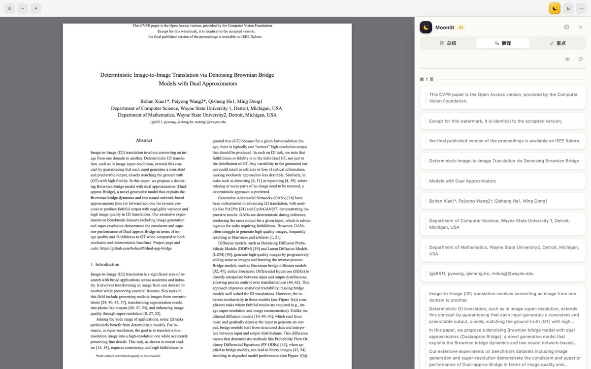
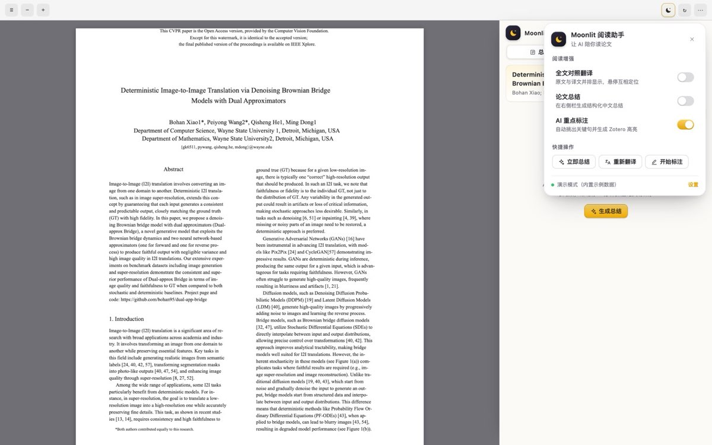

<p align="center">
  
</p>

<h1 align="center">Zotero AI 中文阅读助手</h1>

<p align="center">
  <b>让 Zotero 里的英文论文，直接读中文。</b><br>
  右栏并排显示译文，一键生成总结与重点——只需填一次你自己的 API。
</p>

<p align="center">
  <a href="../../releases/latest"></a>
  <a href="../../releases"></a>
  
  
  <a href="LICENSE"></a>
</p>

<p align="center">
  <a href="../../releases/latest"><b>⬇️ 下载安装</b></a> ·
  <a href="#quick-start">快速上手</a> ·
  <a href="#byo-api">自带 API</a> ·
  <a href="#faq">常见问题</a> ·
  <a href="CHANGELOG.md">更新日志</a>
</p>

---

## ✨ 功能一览

| | 功能 | 说明 |
| :--: | --- | --- |
| 🌏 | **全文中文对照** | 整篇论文按段落翻译，右栏与 PDF 并排；原文小字可开关 |
| 🖱️ | **双向高亮联动** | 悬停译文→原文自动描框并滚动；悬停原文→译文卡片亮起并跟随 |
| 📝 | **结构化总结** | 一句话总结 · 研究问题 · 核心方法 · 主要贡献 · 关键结果 · 局限 · 术语，流式呈现 |
| 🖍️ | **AI 重点标注** | 自动挑出关键句并按类型配色，**写进 Zotero 原生高亮注释**，可检索可同步 |
| 📌 | **划词翻译 / 解释** | 选中任意文本即可「AI 翻译」「AI 解释」，不打断阅读 |
| 🗒️ | **一键保存为笔记** | 总结 + 重点生成 Zotero 笔记，带文献信息与来源标注 |
| 📊 | **用量心里有数** | 右栏底部实时显示本篇 token 用量，按功能分类记账 |
| 📚 | **每篇论文独立** | 开关状态、进度、缓存按论文隔离；可单独清除本篇译文或总结 |
| 🎨 | **原生观感** | 深色 / 浅色自适应，中英文界面自动切换 |

<p align="center">
  
  <br>
  <sub>右栏逐段译文，悬停即与原文联动（截图为自动化审计界面）</sub>
</p>

<a id="byo-api"></a>

## 💡 自带 API，任何模型随你选

插件**不绑定任何服务商**，也不经过我们任何服务器：你填自己的接口地址和 Key，论文只发给你选择的那一家。

- **主流云端**：DeepSeek、OpenAI、Kimi、智谱 GLM、通义千问、SiliconFlow……
- **自己的网关 / 中转**：填完整 Base URL 即可（面板会显示"实际请求地址"，填错一眼看出）
- **完全本地**：Ollama 等本地模型，断网也能翻译
- **成本可控**：用量实时可见；同样一篇论文，选便宜模型和贵模型的差别你自己决定
- **先用后付**：内置「演示模式（无需 API）」，装完就能体验完整交互

## 🚀 安装

1. 打开 [**Releases**](../../releases/latest)，下载 `moonlit-reader-x.y.z.xpi`
2. Zotero → **工具** → **插件** → 右上角 ⚙ → **Install Plugin From File…** → 选择刚下载的 xpi
3. 重启 Zotero

> 支持 Zotero 7 / 8 / 9 / 10（macOS、Windows、Linux）。

<a id="quick-start"></a>

## ⚡ 快速上手

1. **配置一次**：Zotero → 设置 → **AI 中文阅读助手** → 选服务商、填 API Key（或选演示模式）→ 点「测试连接」
2. **打开论文**：在 Zotero 里打开任意 PDF → 点击右上角工具栏的 🌙
3. **打开开关**：翻译 / 总结 / 重点——开关就是全部入口，打开即开始

<p align="center">
  
</p>

每个开关下方会显示它此刻的真实状态：`未开启` / `正在处理 · 12/48` / `已暂停` / `已完成` / `出错了`；
🌙 图标也会同步变成忙碌、暂停或出错的样子。**关掉开关只是暂停**，已完成的部分会留着，再打开就从断点继续。

## ⚙️ 常用设置

| 设置 | 默认 | 什么时候改它 |
| --- | --- | --- |
| 服务商 / Base URL / 模型 | — | 换成你自己的网关或本地模型 |
| 最大输出 tokens | 8192 | 用推理型模型（r1、o 系列）时调大 |
| 并发数 | 3 | 网关限流严格时调小 |
| 每分钟请求上限 | 45 | 网关限制更严时调低，避免 429 |
| 流式输出 | 开 | 代理拦截流式、进度卡住时关掉 |
| 详细日志 | 关 | 需要排查问题时打开（日志在数据目录 `moonlit.log`） |

<a id="faq"></a>

## ❓ 常见问题

<details>
<summary><b>一直"等待模型响应…"或进度不动？</b></summary>

多半是代理拦住了流式响应。插件 15 秒收不到数据会自动改用非流式，也可以在设置里直接关掉「流式输出」。
</details>

<details>
<summary><b>提示「模型没有返回内容」？</b></summary>

推理型模型会先"思考"，输出上限不够就没答案。把「最大输出 tokens」调大（如 16384）。
</details>

<details>
<summary><b>提示 429 / 每分钟请求超限？</b></summary>

网关限流。把「每分钟请求上限」调到网关允许的值，插件会按服务器给出的时间自动等待重试。
</details>

<details>
<summary><b>提示里的请求地址不是我的网关？</b></summary>

Base URL 被清空了。打开设置看「实际请求地址」那一行，重新填一次即可。
</details>

<details>
<summary><b>扫描版 PDF 能翻译吗？</b></summary>

暂时不能——纯图片 PDF 没有文本层，需要 OCR，目前不支持。
</details>

## 🔒 隐私

论文文本只发送给**你自己配置的服务商**；没有遥测、没有中转服务器。Key 存在本机 Zotero 配置，
结果缓存在本地数据目录（可在设置里一键清空）。

## 🛠 开发与贡献

```bash
git clone https://github.com/captainedV/zotero-ai-chinese-reader.git
cd zotero-ai-chinese-reader
npm install
npm test          # 离线单元测试
npm run test:ui   # 无头浏览器 UI 审计
npm run build     # 产出 dist/moonlit-reader-<version>.xpi
```

- 提 Issue 请附：Zotero 版本、服务商/模型、`moonlit.log` 尾部、论文类型（单栏 / 双栏 / 扫描版）。
- 欢迎 PR；改动请带上测试。实现细节见 [设计说明](docs/design-notes.md)，版本变化见 [CHANGELOG](CHANGELOG.md)。

## 🤖 关于本项目

本插件的**全部代码、界面、图标与文档均由 AI 完成**：由 **DSH**（DeepSeek Harness）驱动
**DS4.1 Flash**（DeepSeek V4.1 Flash）编写、自测并迭代，人类负责提出需求、审阅与验收。
从版面解析、翻译调度、开关状态机到图标绘制，整个过程就是一次长时间的 agentic coding 实验。

## 📄 许可

[MIT](LICENSE) · 插件代号 **moonlit** · 插件 ID `moonlit-reader@dsh.local`

---

<p align="center">
  <sub><b>English</b> — Zotero AI Chinese Reader (codename <code>moonlit</code>) reads English papers in
  Chinese inside Zotero's PDF reader: paragraph-level side-by-side translation, a structured summary
  and AI key-point highlights written as native Zotero annotations. Bring your own OpenAI-compatible
  endpoint (DeepSeek, OpenAI, Kimi, GLM, Qwen, SiliconFlow, Ollama or your own gateway) — no telemetry,
  no proxy. Install from <a href="../../releases/latest">Releases</a>. MIT licensed.</sub>
</p>
